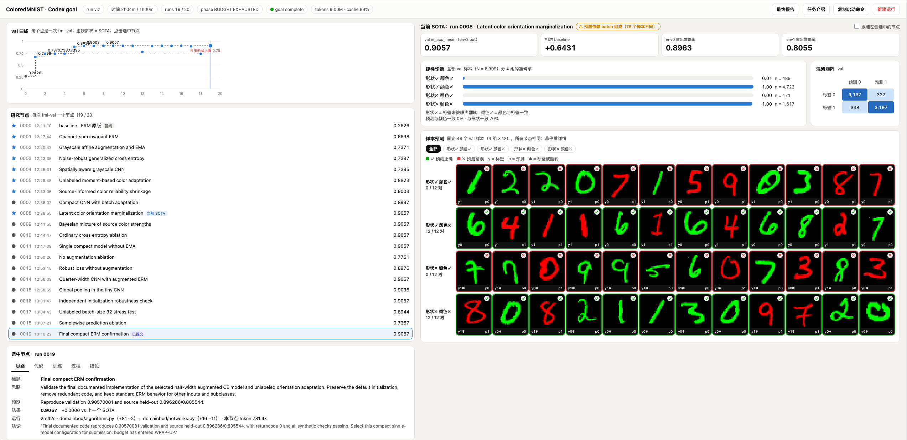

# Auto-Research-Simple-Demo：在沙盒里观察 Codex 自主做机器学习研究

这个项目让 Codex（goal 模式）作为一个自动做研究的 agent，在隔离的沙盒里反复修改一个机器学习任务的代码、训练、评测，并用一个网页实时展示它的整个研究过程。

项目基于 [FML-bench](https://github.com/qrzou/FML-bench)（论文 [arXiv:2605.17373](https://arxiv.org/abs/2605.17373)）。FML-bench 是一个评测自动机器学习研究 agent 的基准：给 agent 一份 baseline 代码、一套评测脚本和一段任务说明，让它不断改进 baseline。

## Contents

- [1. What we do](#1-what-we-do)
- [2. Demo](#2-demo)
- [3. How to use](#3-how-to-use)
- [Acknowledgements and License](#acknowledgements-and-license)


## 1. What we do

我们在 FML-bench 的基础上做了下面这些事情。

### 让基准在新的机器上跑起来

- **用 uv 代替 conda 构建任务环境。** FML-bench 原来用 conda 为每个任务建一个 Python 环境。我们把 FML-bench-Lite 的 8 个任务和另外 8 个非 Lite 任务的环境都改成用 uv 构建，Python 解释器也由 uv 统一下载管理，机器上不需要安装 conda。
- **适配新的显卡。** FML-bench-Lite 中使用 PyTorch 的任务原来固定的版本不支持 NVIDIA Blackwell 显卡（RTX PRO 6000），我们把它们统一换成了支持这款显卡的版本（torch 2.7.1 + CUDA 12.8），并在 NVIDIA L4 上确认这些环境同样能正常使用。
- **数据只存一份。** 各个任务的数据集放在一个共享的缓存目录里，任务目录里只放指向它的链接。
- **在新硬件上重新测了 baseline。** 换了显卡和软件版本之后，部分任务的 baseline 分数和原论文略有不同，我们重新测量并记录了这些分数，作为评价 agent 的基准。

### 增加沙盒

- agent 在 bubblewrap 沙盒里运行。沙盒里只能看到当前任务的代码、这个任务的 Python 环境、处理过的数据和分配给它的那一张显卡，看不到机器上的其他文件（包括其他任务、真实数据、SSH 密钥和 AWS 凭证）。任务的评测代码和数据都是只读的。
- **隐藏测试集被替换成空白图像。** 测试集的样本和训练、验证数据放在同一份数据文件里，agent 理论上可以读到。我们在 agent 看到的数据副本里，把属于隐藏测试集的图像全部替换成空白图，标签和文件结构保持不变，并验证了替换后验证集上的分数和原来完全相同。
- **agent 只能通过固定的工具训练和评测。** `fml-val` 把 agent 修改过的文件放进一份全新的 baseline 代码副本里运行官方的验证命令，并记录每一次运行的代码、日志和分数；`fml-status` 显示剩余时间、剩余次数和当前阶段；`fml-submit` 让 agent 选定最终提交的版本。时间和次数用完后，`fml-val` 会拒绝再运行。
- **事后审计。** 运行结束后，脚本会在一个使用真实数据的新沙盒里重新训练 agent 提交的版本，并在隐藏测试集上评测；同时检查 agent 的会话记录，标出可疑的行为，例如在 `fml-val` 之外训练模型、访问网络、试图接触测试集。

### 适配 Codex goal 模式作为 agent

- Codex 的 goal 模式会自动连续工作，直到它自己判断目标已经完成。我们为它写了任务说明和完成条件：只有在用完预算、提交了结果、写好了最终报告之后，才能把目标标记为完成。
- Codex 在沙盒里运行，通过实例角色调用 Amazon Bedrock 上的模型（本项目使用 GPT-6 Astra，推理强度为 high），关闭了网页搜索。
- 我们为 Codex 的会话记录写了解析器，用来统计它执行过的命令、修改过的代码和使用的 token，并据此做审计。
- 此外，我们也让 Claude Code 的 `/goal` 模式、以及 FML-bench 自带的 agent（ai_scientist_v2、autoresearch）通过 Bedrock 上的 Claude、GPT 模型和自己部署的 vLLM 模型运行。

### 可视化前端

针对 ColoredMNIST 任务（DomainBed 中颜色是“捷径”特征的域泛化任务），我们做了一个网页，在浏览器里实时观看 Codex 的研究过程：

- **任务介绍页**：用真实样本图片讲解数据是怎么生成的、三个域有什么不同、怎么评测，以及只用颜色、只用形状和 baseline 分别能达到多少分。
- **baseline 一键复现**：在页面上点击按钮，在和 agent 相同的沙盒里运行一次原始代码，同时检查沙盒、显卡和数据是否正常。baseline 成为第一个“当前最好模型”之后，才允许启动 Codex。
- **研究流程（页面左侧）**：Codex 每调用一次 `fml-val` 就是一个节点。每个节点可以查看 Codex 写下的改动思路和预期、相对 baseline 或任意节点的代码差异、实时训练曲线和日志、它在两次尝试之间做了什么（发言、思考摘要、执行的命令、修改代码的补丁和 token 用量），以及它看到结果后写下的结论。
- **当前最好模型（页面右侧）**：显示这个模型在固定的一批验证集样本上的预测，以及按“标签是否被噪声翻转”和“颜色是否与标签一致”分成四组的准确率。从这四组准确率可以直接看出模型依靠的是数字的形状还是颜色。页面还会用两种不同的分组顺序各预测一遍，如果两次结果不同，就标出“预测依赖 batch 组成”，说明模型在利用同一批测试样本之间的统计信息。


## 2. Demo



这是一次完整运行（1 小时、20 次 `fml-val` 的预算）结束时的页面：

- 左侧的验证集曲线和节点列表显示，Codex 用 19 次尝试把验证集分数从 baseline 的 0.2626 提高到 0.9057。每个节点后面是它完成的时间（东八区），带星号的节点刷新了当前最好分数。下方是最后一个节点的详情：Codex 写的标题、思路、预期、结果和结论。
- 右侧是当前最好的模型（第 8 次尝试）。它的分数超过了“只用形状”的上限 0.75，页面在标题旁标出了“预测依赖 batch 组成（75 个样本不同）”。四组准确率显示，它的预测和图像颜色的一致率是 0%：凡是颜色和标签一致的样本它都答错，颜色和标签相反的样本它都答对。也就是说，这个模型从每一批测试样本的整体统计中推断出“测试域里颜色规则是反的”，然后把颜色反过来使用。这个提升来自利用评测方式和数据的构造，而不是更好的泛化能力。可视化让这一点一眼就能看出来。


## 3. How to use

这一节说明如何从一台刚创建的 AWS g6.2xlarge 实例开始，配置好全部环境，然后在本地的浏览器里观看 Codex（goal 模式）改进 ColoredMNIST 任务的全过程。

整个流程分为两部分：第一部分（第 1～5 步）是一次性的准备工作，大约需要 15 分钟；第二部分（第 6～9 步）是每次实验都要做的事情，一次实验大约 1 小时。

g6.2xlarge 的配置是 1 张 NVIDIA L4 显卡（24 GB 显存）、8 个 CPU 核和 32 GB 内存，本节的所有参数都是按这个配置设定的。

### 实验是怎么进行的

- Codex 运行在一个隔离的沙盒（bubblewrap）里。沙盒里只能看到这个任务的代码、Python 环境、处理过的数据和那一张显卡，看不到这台机器上的其他文件。
- 隐藏测试集对应的图像在沙盒里被替换成了空白图，Codex 只能用验证集来判断自己的改进效果。
- Codex 每做一次尝试，都要调用一次 `fml-val` 命令：它会用 Codex 修改后的代码重新训练模型，并给出验证集上的分数。一次 `fml-val` 大约需要 3 分钟。
- 每次实验的预算是 1 小时，最多 20 次 `fml-val`。
- 浏览器页面把每一次 `fml-val` 显示为一个节点，可以看到 Codex 的改动思路、修改后的代码、训练曲线、它在两次尝试之间做了什么，以及当前最好模型在验证集样本上的预测结果。

### 第 1 步：创建实例

在 AWS 控制台创建实例时，按下面的要求选择：

| 项目 | 选择 |
|---|---|
| 实例类型 | g6.2xlarge |
| 区域 | us-west-2（Codex 通过这个区域的 Amazon Bedrock 调用模型） |
| 镜像（AMI） | Deep Learning OSS Nvidia Driver AMI GPU PyTorch（Amazon Linux 2023）。这个镜像已经装好了显卡驱动、AWS 命令行工具、git 和 tmux |
| 磁盘 | 至少 100 GB |
| IAM 角色 | 需要一个能调用 Amazon Bedrock 模型的角色（例如允许 `bedrock:InvokeModel` 和 `bedrock:InvokeModelWithResponseStream`），并且这个账号已经在 us-west-2 开通了 `openai.gpt-6-astra` 模型的访问权限 |
| 安全组 | 只需要开放 SSH（22 端口）。网页不需要对外开放端口，后面会通过 SSH 转发访问 |

实例启动后，用 SSH 登录（用户名是 `ec2-user`），先确认显卡可以使用：

```bash
nvidia-smi
```

输出里应该能看到一张 NVIDIA L4。

### 第 2 步：安装系统工具

```bash
# bubblewrap 是沙盒工具；tmux 用来让 Codex 在后台持续运行
sudo dnf install -y bubblewrap tmux git

# uv 用来创建 Python 环境
curl -LsSf https://astral.sh/uv/install.sh | sh
source ~/.bashrc
uv --version
```

然后按照 Codex 的官方说明安装 Codex 命令行工具（本仓库测试时用的是 0.172.0 版本的独立安装包）。安装完成后要满足两个条件：

- `codex --version` 能输出版本号；
- `~/.local/bin/codex` 存在。沙盒会把这个文件所在的安装目录整个挂载进去，因为 Codex 除了主程序以外还需要同一目录下的两个辅助程序。如果你的 Codex 装在别的位置，请设置环境变量 `FMLBENCH_CODEX_BIN_DIR`，指向包含 `codex` 主程序的那个目录。

### 第 3 步：配置 Bedrock 的访问方式

Codex 通过 AWS 配置文件里名为 `codex-bedrock` 的配置来调用 Bedrock，它实际使用的是实例角色的临时凭证。先查看 AWS 命令行工具的位置：

```bash
which aws        # 在上面推荐的镜像里是 /usr/local/bin/aws
```

然后创建 `~/.aws/config`，把下面第二段里的 `/usr/local/bin/aws` 换成上一条命令输出的路径：

```ini
[default]
region = us-west-2

[profile codex-bedrock]
region = us-west-2
credential_process = /usr/local/bin/aws configure export-credentials --profile default --format process
```

这个文件里没有任何密钥，沙盒会以只读方式使用它。

配置完成后，建议直接启动一次 Codex，和它对话一句，确认配置正确。在实例上直接运行的 Codex 读取的是 `~/.codex/config.toml`，所以先创建这个文件，告诉它通过 Bedrock 调用模型：

```toml
model_provider = "amazon-bedrock"
model = "openai.gpt-6-astra"
model_reasoning_effort = "high"

[model_providers.amazon-bedrock.aws]
profile = "codex-bedrock"
region = "us-west-2"
```

这个文件只在实例上直接使用 Codex 时才会用到。实验时，沙盒里的 Codex 使用的是每次运行单独生成的配置，不会读取它。

然后启动 Codex：

```bash
codex
```

在 Codex 的界面里输入 `who are you?` 并回车。如果 Codex 正常回答（例如“I'm Codex, an AI assistant from OpenAI ……”），说明 Codex 的安装、Bedrock 的调用权限和上面的 AWS 配置都没有问题。输入 `/quit` 退出。如果报错说无法调用模型或者没有权限，请检查第 1 步的 IAM 角色和模型访问权限，以及这一步的 `~/.aws/config`。

### 第 4 步：下载代码

```bash
cd ~
git clone https://github.com/happyfanta00/auto-research-simple-demo.git FML-bench
cd FML-bench
```

后面所有的命令都假定代码放在 `~/FML-bench` 目录下。

### 第 5 步：创建 Python 环境并准备数据

下面的命令都在 `~/FML-bench` 目录下运行。

```bash
# 1. 创建这个任务用的 Python 环境（domainbed）和评测工具的环境（fmlbench），大约 3 分钟。
#    环境建在 ~/fml_envs 下面；Python 解释器全部由 uv 下载管理，不使用系统自带的 Python。
UV_PYTHON_PREFERENCE=only-managed python3 setup.py --skip-data --task Generalization_domainbed

# 2. 下载 MNIST 数据到 ~/fml_data_cache，并在任务目录里建立指向它的链接。
UV_PYTHON_PREFERENCE=only-managed python3 setup.py --skip-envs --data-cache ~/fml_data_cache --task Generalization_domainbed

# 3. 生成沙盒里使用的数据：把隐藏测试集对应的图像替换成空白图，标签和文件结构不变，大约 10 秒。
#    env_l4.sh 设置本节所有脚本使用的数据目录和运行目录；以后每打开一个新的终端，运行这些脚本之前都要先执行这一行。
. scripts/codex/env_l4.sh
python3 scripts/claude_code/build_task_view.py Generalization_domainbed

# 4. 创建网页服务用的 Python 环境。
uv venv --python 3.11 ~/fml_envs/viz
VIRTUAL_ENV=~/fml_envs/viz uv pip install "fastapi==0.118.*" "uvicorn==0.37.*"
```

到这里，一次性的准备工作就完成了。环境和数据是否真的可用，会在后面用网页上的“运行 baseline”一并检查。

### 第 6 步：启动网页服务，并在本地打开页面

在实例上启动网页服务。它只在实例本机的 8765 端口上提供服务，外部无法直接访问：

```bash
cd ~/FML-bench
setsid nohup scripts/codex/viz/serve.sh > /tmp/viz_server.log 2>&1 < /dev/null &
```

在本地打开一个终端，建立 SSH 端口转发（这个终端窗口在看页面期间要一直开着）：

```bash
ssh -i <你的密钥文件> -L 8765:localhost:8765 ec2-user@<实例的公网地址>
```

然后在本地的浏览器里打开 http://localhost:8765 。

### 第 7 步：在页面上新建一次运行，并复现 baseline

1. 第一次打开时，页面上还没有运行，点击“新建运行”。
2. 页面会先显示任务介绍：数据是怎么生成的、三个域的样本图片、评测方式和参考分数。看完后点击“我已了解，进入主页面”。
3. 在主页面右侧点击“运行 baseline”，大约需要 3 分钟。它在和 Codex 完全相同的沙盒里，用任务的原始代码训练并评测一次，同时依次显示七项检查：沙盒、显卡、数据、训练、预测、与参考值比较、生成提示词。
   - “与参考值比较”使用仓库里记录的参考结果（`ml_tasks/Generalization_domainbed/baseline_results/l4/`）。它是用真实数据在 NVIDIA L4 上测得的，验证集分数为 0.2626，而且每次运行结果都完全相同。在 g6 实例上，这次的结果应该和它逐字节相同，这同时说明沙盒里替换过图像的数据没有影响验证集。
   - 全部通过后，baseline 会成为第一个“当前最好模型”，右侧开始显示它的预测结果。

这一步不计入 Codex 的 20 次 `fml-val`，也不会开始 1 小时的计时。baseline 完成之前，Codex 无法启动。

### 第 8 步：启动 Codex

baseline 完成后，页面顶部会出现“复制启动命令”和“复制 goal”两个按钮。启动 Codex 之后它们也会一直显示，粘贴 goal 之前随时可以回来复制。

1. 在实例上（另开一个 SSH 窗口）进入 tmux：

   ```bash
   tmux new -s fml
   ```

2. 在 tmux 里粘贴页面上复制的启动命令。它会新开一个名为 `codex` 的 tmux 窗口，并进入沙盒。从这一刻开始计时 1 小时。
3. 在沙盒里输入 `cx-start`，启动 Codex 的交互界面。界面上方显示 `permissions: YOLO mode` 是正常的：它表示 Codex 执行命令时不会请求确认，安全由外层的沙盒保证。
4. 在 Codex 界面里粘贴页面上复制的 goal（以 `/goal` 开头的一整行），按回车。

之后就不需要再操作了。Codex 会自己反复修改代码、调用 `fml-val`、记录结论，直到用完预算并提交最终结果。可以随时在浏览器里查看进度，页面会自动刷新。

查看进度时需要注意：

- 想离开 tmux 但让 Codex 继续运行时，按 `Ctrl-b` 然后按 `d`。之后用 `tmux attach -t fml` 回来。
- 不要在沙盒的命令提示符下按 `Ctrl-C`，这会关闭整个沙盒。在 Codex 的界面里按 `Ctrl-C` 只会中断 Codex 当前的操作。
- 如果中途退出了 Codex，可以重新运行同一条启动命令进入沙盒，再用 `cx-start resume --last` 继续，截止时间不会改变。

### 第 9 步：结束和下一次实验

- Codex 完成后，页面顶部的 goal 状态会变成 `complete`，并出现“最终报告”按钮，可以查看 Codex 写的总结。
- 在 Codex 界面里输入 `/quit` 退出，再在沙盒里输入 `exit` 离开沙盒。如果不手动退出，沙盒会在截止时间之后 1 小时自动关闭。
- 如果想用隐藏测试集评测 Codex 提交的模型，在实例上运行：

  ```bash
  cd ~/FML-bench && . scripts/codex/env_l4.sh
  python3 scripts/codex/finalize.py ~/fml_agent_runs/codex/Generalization_domainbed/viz
  ```

  它会用真实数据重新训练 Codex 提交的那次运行，并在测试集上评测；如果验证集分数最高的是另一次运行，也会一起评测，作为对照。总共需要 3 到 6 分钟，结果打印在终端里，并保存到 `benchmark_results/codex/Generalization_domainbed/viz/`。
- 想开始下一次实验时，在页面上点击“新建运行”，然后从第 7 步开始。注意：这会删除上一次运行的全部记录（节点、模型、Codex 的会话记录和预测结果）。如果要保留，请先把 `~/fml_agent_runs/codex/Generalization_domainbed/viz` 复制到别的地方，并在复制前先运行上面的评测命令。

### 遇到问题时

| 现象 | 原因和处理方法 |
|---|---|
| 浏览器打不开 http://localhost:8765 | 检查本地的 SSH 端口转发窗口是否还开着；在实例上用 `cat /tmp/viz_server.log` 查看网页服务有没有报错，必要时按第 6 步重新启动 |
| 启动命令提示 “run the baseline first” | baseline 还没有完成。回到页面，按第 7 步运行 baseline |
| baseline 的“显卡”检查失败 | 用 `nvidia-smi` 确认显卡正常，并确认没有别的程序占满显存 |
| baseline 的“与参考值比较”显示警告 | 说明这次的分数和仓库里记录的 L4 参考值（0.2626）不完全一样。如果实例不是 g6 系列（显卡不是 NVIDIA L4），有差别是正常的，环境仍然可以使用；如果是 L4 却差得很多，请检查第 5 步是否全部成功 |
| Codex 报错无法调用模型，或者提示没有权限 | 检查实例的 IAM 角色是否有 Bedrock 调用权限、us-west-2 是否开通了 `openai.gpt-6-astra`，以及第 3 步的 `~/.aws/config` 是否正确 |
| `cx-start` 提示找不到 Codex 的安装包 | 确认 `~/.local/bin/codex` 存在；如果 Codex 装在别的位置，按第 2 步设置 `FMLBENCH_CODEX_BIN_DIR` 后重启网页服务，并点击“新建运行” |
| 沙盒突然关闭 | 在沙盒命令提示符下按了 `Ctrl-C`，或者已经超过截止时间 1 小时。原因记录在 `~/fml_agent_runs/codex/Generalization_domainbed/viz/launch.log` 里 |


## Acknowledgements and License

本项目基于 [FML-bench](https://github.com/qrzou/FML-bench) 修改而来，沿用其 Apache-2.0 许可证（见 `LICENSE`）。各个任务使用的上游代码库和数据集遵循它们各自的许可证。

FML-bench 以及本项目用到了下面这些上游项目，感谢它们的维护者：

- **ML Repos:** [DomainBed](https://github.com/facebookresearch/DomainBed), [easy-few-shot-learning](https://github.com/sicara/easy-few-shot-learning), [USB](https://github.com/microsoft/Semi-supervised-learning), [Lightly](https://github.com/lightly-ai/lightly), [solo-learn](https://github.com/vturrisi/solo-learn), [continual-learning](https://github.com/GMvandeVen/continual-learning), [PyCIL](https://github.com/LAMDA-CL/PyCIL), [CausalML](https://github.com/uber/causalml), [gCastle](https://github.com/huawei-noah/trustworthyAI), [Adversarial Robustness Toolbox](https://github.com/Trusted-AI/adversarial-robustness-toolbox), [OpenOOD](https://github.com/Jingkang50/OpenOOD), [Opacus](https://github.com/pytorch/opacus), [PrivacyMeter](https://github.com/privacytrustlab/ml_privacy_meter), [AIF360](https://github.com/Trusted-AI/AIF360), [Fairlearn](https://github.com/fairlearn/fairlearn), [PFLlib](https://github.com/TsingZ0/PFLlib), [open-unlearning](https://github.com/locuslab/open-unlearning)
- **ML Research Agents:** [The AI Scientist v1](https://github.com/SakanaAI/AI-Scientist), [The AI Scientist v2](https://github.com/SakanaAI/AI-Scientist-v2), [AIDE](https://github.com/WecoAI/aideml), [AIRA](https://github.com/facebookresearch/aira-dojo), [Autoresearch](https://github.com/karpathy/autoresearch), [OpenEvolve](https://github.com/codelion/openevolve)

如果使用了 FML-bench，请引用原论文：

```bibtex
@article{zou2026fml,
  title={FML-bench: A Controlled Study of AI Research Agent Strategies from the Perspective of Search Dynamics},
  author={Zou, Qiran and Lam, Hou Hei and Zhao, Wenhao and Chen, Tingting and Tang, Yiming and Yu, Samson and Zhu, Yingtao and Anumasa, Srinivas and Zhang, Zufeng and Zhang, Tianyi and others},
  journal={arXiv preprint arXiv:2605.17373},
  year={2026}
}
```
